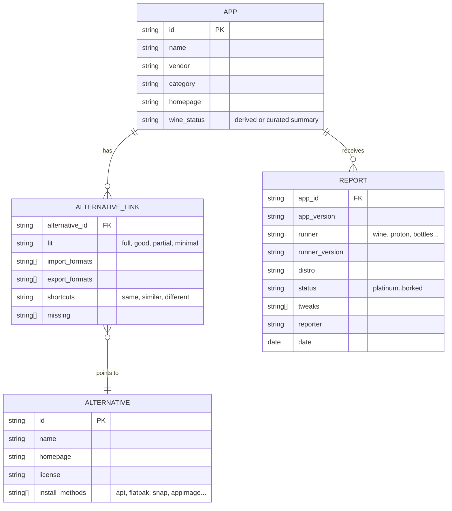
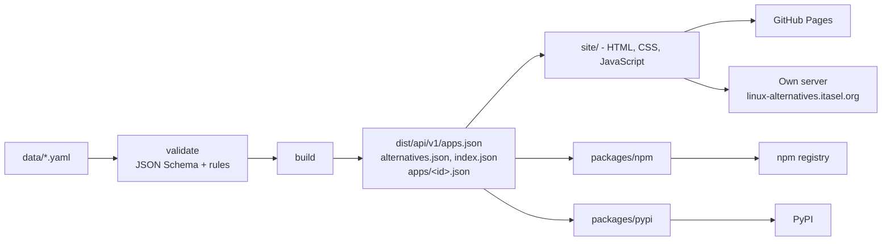
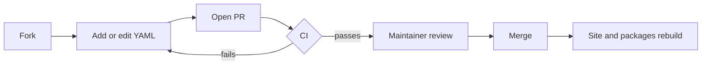

# Architecture proposal

Status: **partially implemented**, open for discussion. Data validation, the JSON API and the static search site are implemented. Packages and the other planned services below are not yet available.

## 1. Goals and non-goals

**Goals**

1. A community-maintained, versioned, machine-readable database of Windows apps, their Linux alternatives, and Wine/Proton compatibility.
2. Contributing means adding a small YAML file through a PR. No code skills needed.
3. Other projects can depend on it (npm, PyPI, raw JSON).
4. Every change is validated automatically, so quality does not depend on reviewer attention alone.

**Non-goals (for now)**

- Games. ProtonDB already covers them. We may link out to it.
- Hosting binaries, installers, or cracked/pirated software links.
- User accounts, a backend server, or a database service. Git is the database.

## 2. Principles

- **Git is the database.** History, review, blame and rollback come for free.
- **Static everything.** The site and the API are generated files, so hosting is free and nothing can go down.
- **Small files, few conflicts.** One entity per file. Reports are separate from app entries.
- **Schema first.** If it is not in the JSON Schema, it is not in the data.
- **Honest data.** Unknown is a valid value (`untested`). Claims need a source or a verifying contributor.

## 3. Repository layout

```
linux-alternatives/
├─ data/
│  ├─ apps/                  # Windows apps, one file each     (autocad.yaml)
│  ├─ alternatives/          # Linux apps, one file each       (freecad.yaml)
│  ├─ reports/<app-id>/      # compatibility reports, one file per report
│  └─ **/_template.yaml      # starting point per folder (ignored by the validator)
├─ schema/
│  ├─ app.schema.json
│  ├─ alternative.schema.json
│  └─ report.schema.json
├─ tools/                    # validate + build (JavaScript, Node)
├─ site/                     # static website (HTML, CSS, JavaScript)
│  ├─ partials/              # shared header and footer, inlined at build time
│  ├─ plan-core.js           # pure logic of the switch planner (unit tested)
│  └─ fonts/                 # self-hosted Montserrat (SIL OFL)
├─ packages/
│  ├─ npm/                   # @linux-alternatives/data
│  └─ pypi/                  # linux-alternatives
├─ deploy/                   # self-hosting: Dockerfile, compose, nginx config
├─ docs/
│  ├─ ARCHITECTURE.md        # this file
│  ├─ SELF_HOSTING.md        # run the site on your own server
│  ├─ LICENSING.md           # who is licensed under what, and why
│  └─ CODE_OF_CONDUCT.md
├─ .github/
│  ├─ ISSUE_TEMPLATE/        # compatibility-report, add-an-app
│  ├─ workflows/             # ci.yml, deploy-site.yml, deploy-server.yml
│  └─ PULL_REQUEST_TEMPLATE.md
├─ CONTRIBUTING.md
├─ LICENSE                   # code (MIT)
└─ LICENSE-DATA              # data (CC0 1.0)
```

## 4. Data model

Three entity types. Alternatives are normalised into their own files, so "FreeCAD" is described once and referenced from many apps.



### Rating scales

| Field | Values | Meaning |
| --- | --- | --- |
| `fit` | `full` `good` `partial` `minimal` | How well the alternative replaces the Windows app for typical use |
| `status` | `platinum` `gold` `silver` `bronze` `borked` `untested` | Wine/Proton result (same vocabulary as WineHQ and ProtonDB, so it is familiar) |
| `shortcuts` | `same` `similar` `different` | How transferable muscle memory is |

### Aggregating reports

The app's summary status is **derived** at build time from its reports (the most common status among its reports; ties go to the most recent report), not typed by hand. A curated `wine.summary` text can still be written for context. This keeps the headline number honest as reports accumulate.

### Identity and naming

- `id` is a lowercase slug, equal to the filename (`adobe-photoshop` is `adobe-photoshop.yaml`).
- Versions are free strings (`"2024"`, `"CS6"`); the schema does not parse them.
- Categories come from a fixed enum in the schema (`cad`, `accounting`, `graphics`, `office`, `printing`, `engineering`, ...), extended by PR.

## 5. Build pipeline



**Validation (runs on every PR):**

1. YAML parses and passes the JSON Schema.
2. `id` equals filename; ids are unique.
3. Referential integrity: every `alternative_id` and report `app` exists.
4. Links are well-formed (optional scheduled job checks that they are alive).
5. Formatting is normalised (sorted keys, consistent style) to keep diffs small.

**Build outputs** are plain JSON, versioned together with the repo, and are never committed. CI generates them.

## 6. Consumption

| Consumer | How |
| --- | --- |
| Humans | Static site with instant search by app name, category, or alternative, plus a client-side switch planner that turns a list of Windows apps into a plan and an install script. The selection lives only in the URL hash: nothing is uploaded or stored |
| JS / TS tools | `npm i @linux-alternatives/data` with typed access and lookup helpers |
| Python tools | `pip install linux-alternatives` |
| Anything else | Raw JSON from the public site: `/api/v1/apps.json`, `/api/v1/apps/<id>.json` (CORS open to any origin on the self-hosted instance) |
| Distros / themes | Embeddable "Coming from Windows?" widget built from the same JSON |

The JSON API is versioned (`/api/v1/`). Breaking schema changes bump the major version.

## 7. Versioning and releases

- Data releases use **CalVer** (`2026.03.1`) since data changes continuously.
- The schema has its own **semver**; packages declare which schema versions they support.
- A scheduled workflow publishes packages (monthly, or on demand) from `main`.

## 8. Contribution workflow



- **Issue templates** for "Add an app" and "Compatibility report". Reports can optionally be converted into a PR file by a bot later, so non-technical users never need Git.
- `CODEOWNERS` routes categories to domain reviewers (e.g. CAD, accounting) as the community grows.
- PRs should stay at one app each. A bot can label by category and flag unsourced claims.

## 9. Quality and trust

- Reports carry reporter handle, date, and versions, so stale data is visible and can be aged out.
- Entries older than a threshold are flagged "needs re-verification" on the site.
- The site renders app details, alternative source links and compatibility reports using `textContent`. Reports show the app and runner versions, distribution, date, reporter, adjustments and notes, sorted newest first. Adjustment values are displayed as text, not assembled into shell commands. Empty report lists are explicitly shown as untested.
- No telemetry, no cookies, no third-party scripts on the site.
- The self-hosted instance enforces this with a strict Content-Security-Policy (`script-src 'self'`, no inline code), `nosniff`, no framing, and read-only methods on `/api/`.

## 10. Tech choices

| Concern | Choice | Why |
| --- | --- | --- |
| Data format | YAML | Friendliest for non-developers, supports comments |
| Validation | JSON Schema (draft 2020-12) | Language-neutral; editors show inline errors |
| Tooling | JavaScript on Node | Same ecosystem as the planned npm package and site |
| Site | HTML, CSS and JavaScript | Fully static, client-side search with no server or framework. The build only inlines the shared header/footer and writes canonical URLs, `sitemap.xml` and `robots.txt` (`SITE_URL` sets the domain). No inline scripts or styles, so a strict CSP works |
| Design | Tokens shared with itasel.org | Dark-first, gold accent, Montserrat; light theme via `prefers-color-scheme` |
| Hosting | GitHub Pages and/or own server (nginx) | The output is plain static files, so any web server works. See [SELF_HOSTING.md](SELF_HOSTING.md) |
| CI | GitHub Actions | Native to the repo |

Alternatives considered: TOML (less familiar), a hosted database (cost, ops, lock-in), a Next.js site (heavier than needed).

## 11. Licensing

Decided (see [LICENSING.md](LICENSING.md)):

- **Code** (tools, site, packages, docs): [MIT](../LICENSE).
- **Data** (`data/`, `schema/`): [CC0 1.0](../LICENSE-DATA). The point is that distros, migration tools and websites can embed the data with no friction; CC0 has no attribution or share-alike requirement. This is hard to change once there are many contributors, so it was settled before the first external PR.
- Contributions are accepted under the same terms, stated in `CONTRIBUTING.md` and the PR template (no CLA and no DCO sign-off for now).
- Contributors must not copy text from other databases: facts are free, wording may not be.

## 12. Milestones

| Milestone | Scope |
| --- | --- |
| **v0.1** | Schemas, `data/` skeleton, validate script, CI (done); 50–100 seed apps (in progress) |
| **v0.2** | Static site, issue templates, `good first issue` backlog |
| **v0.3** | npm + PyPI packages, JSON API, public announcement |
| **v1.0** | Stable schema, 20+ outside contributors, embeddable widget |

## 13. Open questions

1. ~~Data license~~ Decided: CC0 for data, MIT for code.
2. Final project name and org (the repo is currently `linux-alternatives`).
3. Do we accept Wine reports without a reporter handle (anonymous), or require a GitHub identity?
4. Scope of "professional" software at launch: which 5–6 categories to seed first?
5. Do we link to or import from existing sources (WineHQ AppDB, ProtonDB) and under what terms?
